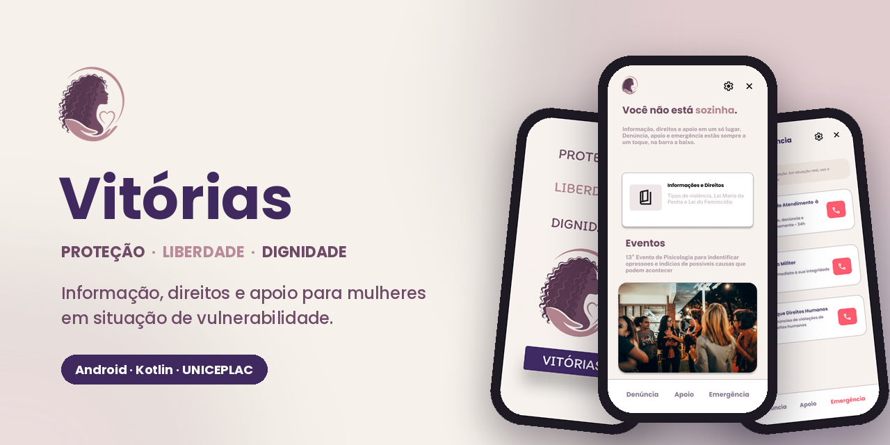
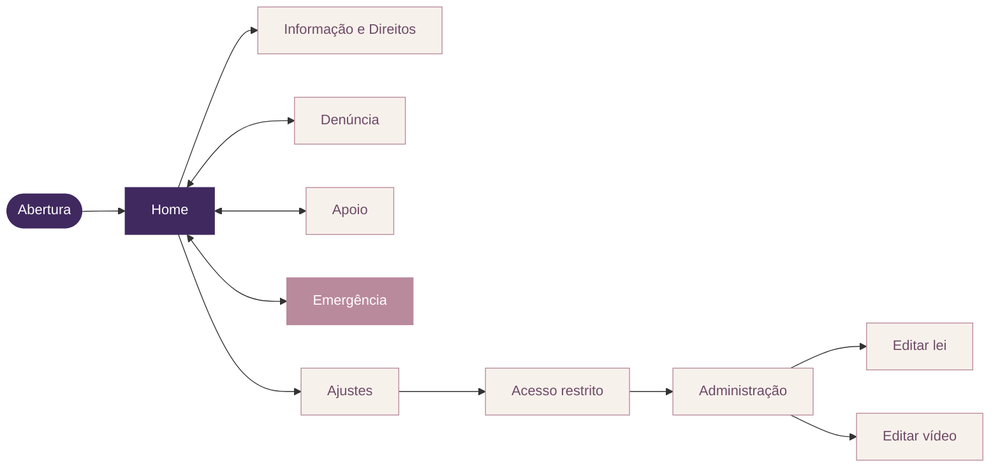
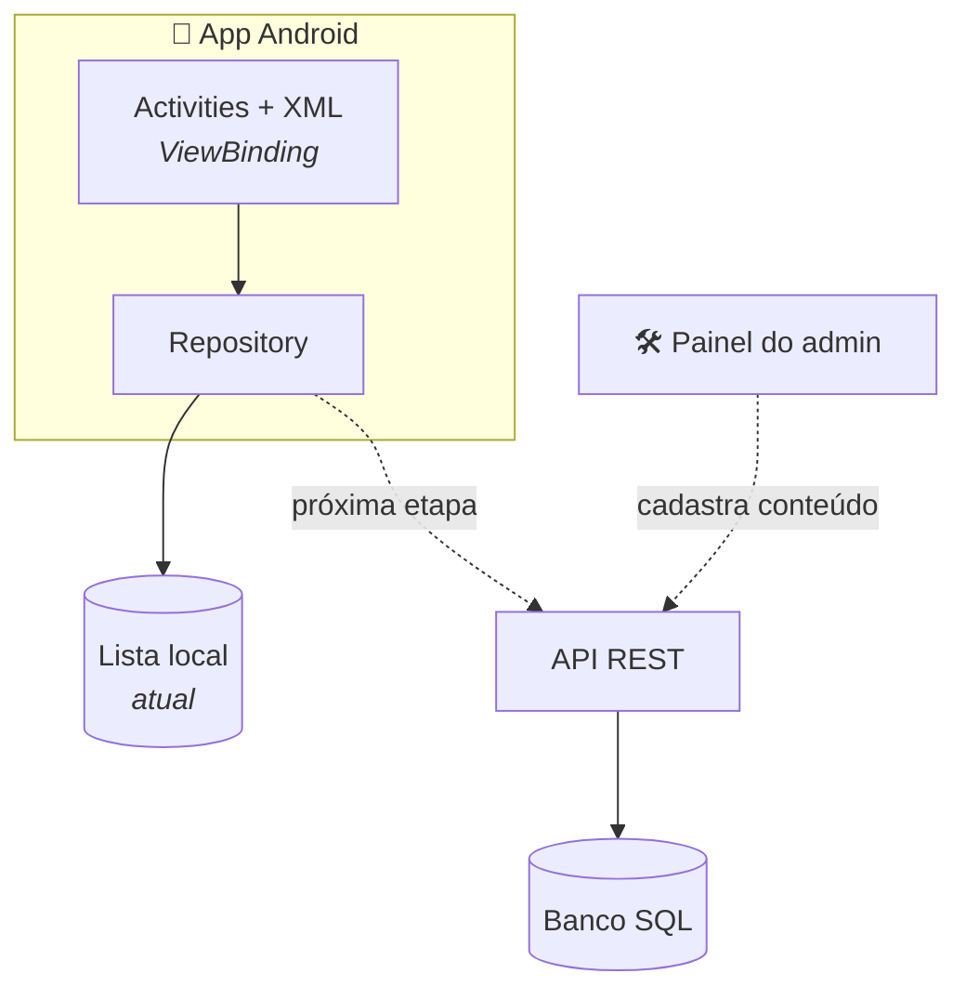
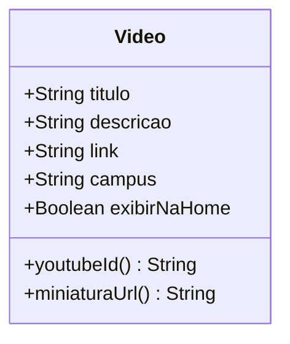
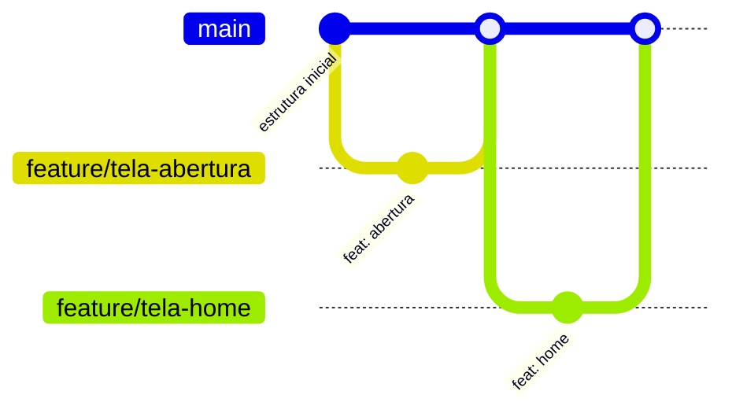

<div align="center">



<br/>

[](https://github.com/MatheusMatiasCoutinho/Vitorias/actions/workflows/android.yml)


**[Sobre](#-sobre)** ·
**[Telas](#-telas)** ·
**[Arquitetura](#%EF%B8%8F-arquitetura)** ·
**[Segurança](#-privacidade-por-design)** ·
**[Roadmap](#%EF%B8%8F-roadmap)** ·
**[Executar](#-como-executar)** ·
**[Contribuir](#-como-contribuir)**

</div>

<br/>

> [!CAUTION]
> O Vitórias é informativo e **não substitui atendimento oficial**.
> Em risco imediato, ligue **190**. Para orientação e denúncia, **Ligue 180** — gratuito, 24h, em todo o Brasil.

<br/>

## 💜 Sobre

O **Vitórias** é um aplicativo Android de conscientização, orientação e apoio a mulheres em situação de vulnerabilidade, desenvolvido como projeto acadêmico do curso de **Engenharia de Software da UNICEPLAC**.

O app reúne, em linguagem acessível, os tipos de violência previstos na Lei Maria da Penha, a legislação vigente e a rede de atendimento público gratuito — Defensoria Pública, Casa da Mulher Brasileira, CRM, CREAS, CAPS e DEAM — com atalhos diretos para os canais de emergência.

Muitas usuárias podem estar sob vigilância de quem as agride. Por isso o projeto parte de uma premissa: **o app nunca pode virar prova contra quem o usa**. Sem cadastro, sem relatos na nuvem e com saída em um toque.

<br/>

## ✨ Funcionalidades

| | Módulo | O que faz |
|:---:|---|---|
| 📖 | **Informação e Direitos** | Explica os 5 tipos de violência do Art. 7º da Lei nº 11.340/2006 e resume a Lei Maria da Penha e a Lei do Feminicídio (Lei nº 13.104/2015) |
| 🎬 | **Eventos** | Carrossel automático de palestras e campanhas; cada vídeo tem descrição e link próprios |
| 🚨 | **Emergência** | Ligue 180, 190 e Disque 100 — abre o discador com o número pronto |
| 📍 | **Apoio** | Rede de atendimento mais próxima, por geolocalização, com rota até o local |
| 📝 | **Denúncia** | Ajuda a organizar o relato, em primeira ou terceira pessoa — salvo **só no aparelho** |
| 🛠️ | **Administração** | Gestão de vídeos e leis sem precisar publicar nova versão na loja |

<br/>

## 📱 Telas

<sub>Protótipo de alta fidelidade desenhado no Figma. As telas já implementadas estão marcadas no [roadmap](#%EF%B8%8F-roadmap).</sub>

<table align="center">
  <tr>
    <td align="center"><br/><sub><b>Abertura</b></sub></td>
    <td align="center"><br/><sub><b>Home</b></sub></td>
    <td align="center"><br/><sub><b>Emergência</b></sub></td>
    <td align="center"><br/><sub><b>Denúncia</b></sub></td>
  </tr>
  <tr>
    <td align="center"><br/><sub><b>Tipos de violência</b></sub></td>
    <td align="center"><br/><sub><b>Direitos e leis</b></sub></td>
    <td align="center"><br/><sub><b>Ajustes</b></sub></td>
    <td align="center"><br/><sub><b>Acesso restrito</b></sub></td>
  </tr>
</table>

<details>
<summary><b>🛠️ Ver telas da área administrativa</b></summary>
<br/>
<p align="center">
  
  &nbsp;&nbsp;
  
</p>
</details>

<br/>

## 🧭 Fluxo de navegação



<sub>🟪 Implementada &nbsp;·&nbsp; 🟫 Em desenvolvimento &nbsp;·&nbsp; ⬜ Planejada &nbsp;·&nbsp; Denúncia, Apoio e Emergência ficam na barra inferior, acessíveis de qualquer tela.</sub>

<br/>

## 🏗️ Arquitetura

As telas não sabem de onde os dados vêm: elas pedem ao **Repository**. Hoje ele lê uma lista local; na próxima etapa passa a consultar a API. A fonte de dados muda **sem tocar na interface**.



> [!IMPORTANT]
> O app **nunca** se conecta direto ao banco. Todo acesso passa pela API, que autentica o admin e guarda as credenciais do banco fora do APK — qualquer coisa embutida no app pode ser extraída.

<details>
<summary><b>📦 Modelo de dados — Vídeo</b></summary>
<br/>



A miniatura não é armazenada: é gerada a partir do ID do vídeo no YouTube. O admin cadastra só o link, e só vídeos com `exibirNaHome = true` entram no carrossel.

</details>

<details>
<summary><b>🗂️ Estrutura de pastas</b></summary>
<br/>

```
app/src/main/
├── java/br/edu/uniceplac/vitorias/
│   ├── AberturaActivity.kt      # Tela inicial
│   ├── MainActivity.kt          # Home + carrossel automático
│   ├── LoginActivity.kt         # Acesso restrito (admin)
│   ├── Video.kt                 # Modelo de dados
│   ├── VideoRepository.kt       # Fonte dos vídeos
│   └── VideoAdapter.kt          # Cards do carrossel
└── res/
    ├── layout/                  # Telas e componentes reutilizáveis
    ├── values/                  # Cores e textos (strings.xml)
    └── drawable/                # Ícones vetoriais e logo
```

</details>

<br/>

## 🔒 Privacidade por design

Cada decisão técnica abaixo existe para proteger quem usa o app.

| Decisão | Por quê |
|---|---|
| **Sem cadastro para a usuária** | Nenhum dado pessoal liga a pessoa ao aplicativo |
| **`allowBackup="false"`** | Os relatos não são copiados para a nuvem do Google |
| **Telas internas com `exported="false"`** | Nenhum outro app abre uma tela interna sem passar pela abertura |
| **Saída rápida (✕) em todas as telas** | Fecha o app inteiro com um toque |
| **`ACTION_DIAL` em vez de ligação direta** | Não exige permissão sensível; a usuária confirma antes de ligar |
| **Login apenas para administradores** | Só quem publica conteúdo precisa de conta |
| **Modo camuflado e limpeza de histórico** *(planejado)* | Disfarça a interface e apaga rastros de uso |

<br/>

## 🎨 Identidade visual

<p>
  
  
  
  
  
</p>

Tons de roxo e malva, associados ao **Agosto Lilás** e à luta pelo fim da violência contra a mulher. O vermelho é reservado às ações de emergência, para que nunca se confunda com o resto da interface. Tipografia: **Poppins**.

<br/>

## 🗺️ Roadmap

- [x] Estrutura do projeto, repositório e fluxo de branches
- [x] Abertura
- [x] Home com carrossel automático de vídeos
- [x] Barra de navegação inferior compartilhada
- [ ] Emergência — Ligue 180, 190 e Disque 100
- [ ] Informação e Direitos
- [ ] Denúncia com armazenamento local
- [ ] Apoio com geolocalização da rede de atendimento
- [ ] Ajustes, saída rápida e modo camuflado
- [ ] Área administrativa, API REST e banco SQL

<br/>

## 🛠️ Tecnologias

| Camada | Tecnologia |
|---|---|
| Linguagem | Kotlin |
| Interface | Android Views (XML) · ViewBinding · Material Components 3 |
| Componentes | ViewPager2 (carrossel) · Coil (imagens remotas) |
| Build | Gradle Kotlin DSL · minSdk 24 |
| Backend | API REST + banco SQL *(em desenvolvimento)* |
| CI/CD | GitHub Actions — build, testes e APK a cada push |
| Design | Figma |

<br/>

## 🚀 Como executar

**Pré-requisitos:** Android Studio atualizado e um emulador ou aparelho com Android 7.0 (API 24) ou superior.

```bash
git clone https://github.com/MatheusMatiasCoutinho/Vitorias.git
```

1. No Android Studio: **File → Open** e selecione a pasta clonada.
2. Aguarde o **Gradle Sync**.
3. Escolha um dispositivo e clique em **Run ▶**.

> [!TIP]
> Quer só instalar no celular? Cada build da `main` gera um APK: abra a aba **[Actions](https://github.com/MatheusMatiasCoutinho/Vitorias/actions)**, entre no último build verde e baixe **vitorias-debug-apk** em *Artifacts*.

<br/>

## 🤝 Como contribuir



1. Crie uma branch a partir da `main`: `feature/<nome-da-tela>`
2. Faça commits pequenos, seguindo o padrão abaixo
3. Abra um **Pull Request** para a `main` — nada entra direto nela
4. Aguarde o **GitHub Actions** compilar e testar: PR com build vermelho não entra

| Prefixo | Uso | Exemplo |
|---|---|---|
| `feat` | Nova funcionalidade | `feat: adiciona tela de emergência` |
| `fix` | Correção de bug | `fix: corrige crash ao abrir vídeo` |
| `docs` | Documentação | `docs: atualiza README` |
| `refactor` | Melhoria sem mudar comportamento | `refactor: extrai card de emergência` |
| `chore` | Configuração e manutenção | `chore: atualiza dependências` |

> [!WARNING]
> Nunca commite chaves de API, senhas ou o `local.properties`. Uma chave apagada em commit posterior **continua no histórico** do Git.

<br/>

## 📞 Rede de atendimento

| Canal | Número | Quando usar |
|---|:---:|---|
| Central de Atendimento à Mulher | **180** | Orientação, denúncia e encaminhamento — 24h, gratuito |
| Polícia Militar | **190** | Risco imediato |
| Disque Direitos Humanos | **100** | Violações de direitos humanos |

<br/>

## 👥 Equipe

<table>
  <tr>
    <td align="center" width="160">
      <a href="https://github.com/MatheusMatiasCoutinho">
        <br/>
        <sub><b>Matheus Matias Coutinho</b></sub>
      </a><br/>
      <sub><b>Tech Lead</b><br/>Desenvolvedor Android · UI/UX</sub>
    </td>
    <!-- Para adicionar um integrante: copie o bloco <td> acima e troque o usuário do GitHub -->
  </tr>
</table>

<br/>

## 📄 Licença

Distribuído sob a licença **MIT**. Veja [LICENSE](LICENSE).

<br/>

<div align="center">


<sub>Feito com 💜 por estudantes de Engenharia de Software da **UNICEPLAC**</sub>

<sub><a href="#">⬆ voltar ao topo</a></sub>

</div>
